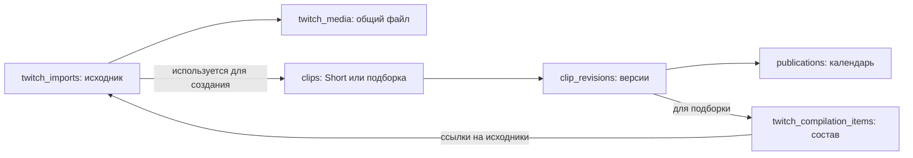

# Подготовка Twitch: подборки, бюджет и полный сброс

Основная среда — LT-Inc staging. Изменения конфигурации и dashboard находятся
в связанном PR репозитория k3s. Новых секретов этот выпуск не требует.

## Почему не получается подборка

Откройте **Twitch → Подборки**, выберите поток. Диагностика обновляется раз
в 10 секунд, пока вкладка видима. Она ничего не создаёт и не резервирует.

- «Готово» — только проверенные допустимые файлы, выбранные тем же алгоритмом,
  что реальная сборка. Секундные переходы входят в длительность.
- «В работе» — очередь, скачивание, проверка и повторные попытки. Эти секунды
  не прибавляются к готовому выпуску.
- Показываются дефицит длины и количества, ближайшее место, ограничения
  канала, ошибки и следующее действие. Категории открывают исходники с причиной.
- Счётчик всех найденных материалов не означает, что эти файлы скачаны.
  Старые, исключённые, неподходящие и уже использованные материалы отделены.
- При недоступности collector сведения о его задачах неполные; это не нулевая
  очередь и не отсутствие клипов.

Сборщик использует все подходящие готовые исходники потока, включая общие
файлы вне первой партии. Рендер начинается сразу после достижения минимума,
время публикации задаётся отдельно. Если минимума нет, короткая подборка
автоматически не выпускается. Не нужно ждать прежнего часа подготовки.

## Бюджет и конкуренция

В **Twitch → Настройки сервиса** задаются общий суточный лимит новых файлов,
лимит одного стримера и доля подборок: по умолчанию **70%**, диапазон 0–100%.
Остаток предназначен Shorts. Невостребованная доля доступна другому формату.
Доля не увеличивает общий лимит скачиваний.

Один файл скачивается один раз и может использоваться в обоих форматах и
нескольких потоках. Использование в Short не исключает его из подборки.
Бюджет относится к новым физическим загрузкам, а не к каждому использованию.
Внутри подготовки подборок предпочтение получает завершение ближайшего
выпуска; равные потребности потоков обслуживаются сохранённой очередью.
Потоки одного фактического YouTube-канала делят его календарные ограничения.

Сначала проверяйте режим **shadow**: он показывает новые решения, сохраняя
прежнее распределение. После проверки включите **enforce** в настройках
сервиса — collector будет исполнять назначения main-be. Перезапуск приложения
не сбрасывает сохранённые назначения и распределение.

Расчёт достижимости показывает используемую оценку длины клипа. Например,
для трёх ежедневных подборок по 8 минут из независимых 30-секундных клипов
понадобится примерно 48 файлов в сутки. При бюджете 10 эта цель не достижима
стабильно. Можно увеличить бюджет или изменить требования; система не
снижает минимальную длину и не продлевает свежесть самостоятельно.

## Язык и автоматическое одобрение

Twitch Get Clips возвращает язык в данных клипа, но не принимает фильтр
`language`. Terex проверяет язык после получения страниц. В языковой поток
допускается только подтверждённый язык самого клипа; текущий язык канала —
подсказка, а не подтверждение языка исторической записи. Старые метаданные
без источника языка перепроверяются при очередном discovery.

Неподходящие языки скрыты по умолчанию, но доступны в отфильтрованных.
Причина показывает требуемый и фактический язык. Достижение предела поиска
не означает, что во всей категории нет нужного языка. API-метаданные не
подтверждают фактический язык речи; распознавание аудио не входит в этот выпуск.

Для Twitch ручного этапа одобрения нет. Конкретная версия автоматически
одобряется только после успешного рендера и проверок исходников. Редактирование
создаёт новую версию; до её готовности она не публикуется. Уже начатая загрузка
остаётся привязана к прежней версии. Переключатель автопубликации, пауза,
отмена, фильтры, календарь и неопределённый результат YouTube сохраняют силу.
Существующие YouTube jobs используют свой прежний режим одобрения.

## Полный сброс Twitch

**Twitch → Настройки сервиса → Полный сброс Twitch** — отдельная операция, не очистка
по сроку хранения. Сначала показываются записи, файлы, объём и препятствия.
Для запуска подтвердите показанный расчёт фразой **RESET TWITCH**.

Удаляются Twitch-импорты, найденные клипы, задания, готовые выпуски и подборки,
версии, календарные записи, история публикаций и сведения об использовании
источников. Настройки потоков, подключения, секреты, оформительские assets и
обычные YouTube jobs сохраняются. Общие файлы с зависимостями вне сброса не
удаляются. Опубликованные видео на самом YouTube не удаляются.

Во время сброса Twitch приостановлен. Начатые либо неопределённые загрузки
сначала должны завершиться или пройти сверку. Сохраняемая операция показывает
прогресс и продолжается после перезапуска; старые обработчики не могут вернуть
удалённые данные. Ошибка удаления не означает успешное завершение.

После завершения потоки остаются выключенными. Запустите их явно, когда
готовы начать заново. Поскольку история использования удалена, те же Twitch-
клипы могут быть выбраны и опубликованы повторно, если проходят свежие фильтры.

## Что хранится в БД

`twitch_imports` — происхождение и состояние получения исходника, даже когда
файла ещё нет. `twitch_media` — проверенный общий исходный файл. `clips` —
наш Short или подборка. `clip_revisions` — точная версия монтажа.
`publications` — её назначение аккаунту, время и результат публикации.

Схема упрощена: `twitch_flow_sources` связывает импорт с потоками,
`twitch_outputs` — поток с его выпуском. В собственной схеме collector лежат
метаданные Twitch-клипов и задания скачивания; main-be не пишет туда напрямую.
